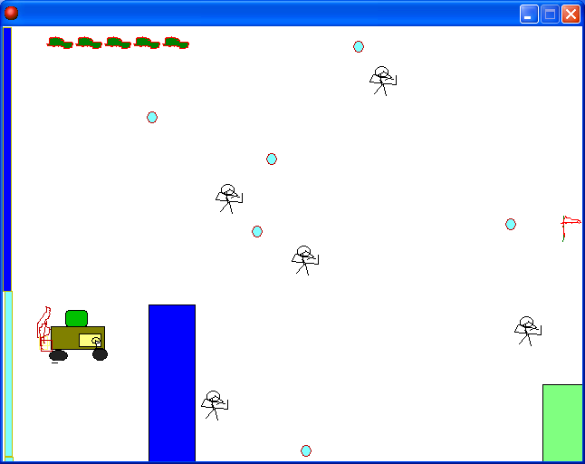

# Convict Drive

[한국어](README.ko.md)

A game where you drive a car through armed enemies and incoming bullets to reach the clear point. It has a lives system, stages and a boss fight.

  

## How to play

Download from Releases and run it.

Move the car with the arrow keys and hold space to stop. Getting hit by an enemy bullet costs one life, and touching the clear point on the right side of the screen moves you to the next stage. There are four stages with a boss fight along the way.

Remaining lives are shown as icons at the top of the screen. Lose every life and the game returns to the title screen.

## How it works

Lives use GameMaker's built-in `life` value directly. A lives object placed in each stage room sets `life` to 5 whenever the room is entered, then checks every frame whether any lives are left and sends you back to the title the moment it hits 0. The life icons at the top of the screen are drawn by a built-in action that repeats a sprite as many times as the `life` value.

## Source vs. release

The project file in `source/` was reworked once more after the release build was made. In this version you score points when you take out an enemy or clear a stage, remaining lives and the score appear in the window title bar, and the high score table shows up once every life is lost. The car breaking when a bullet hits it also changed in this version. The executable in Releases is the build that was distributed at the time, left unchanged.

## Files

| Path | Contents |
|---|---|
| `source/convict-drive.gmk` | Original project file |
| `source/split/` | Text tree produced by GmkSplitter |
| `docs/screenshots/` | Screenshots |
| Releases | Distributed build |

## License

CC BY-NC-ND 4.0. Unmodified copies may be shared for noncommercial purposes with attribution. Distributing modified versions and commercial use are not allowed. Bundled libraries, graphics, sounds, and maps made by other people keep their own rights. See [LICENSE](LICENSE).
